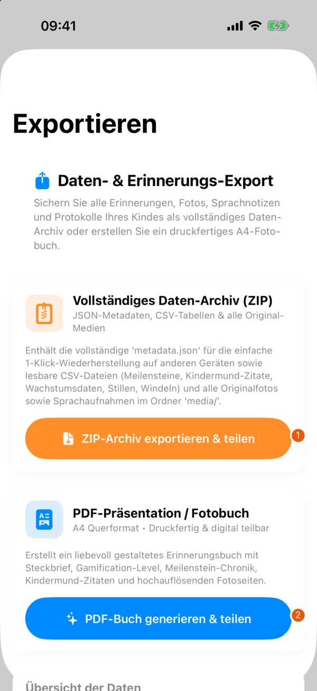

# Backup and deletion

## Creating a backup

{ width=260 }

| No. | Element | Function |
| --- | --- | --- |
| 1 | "ZIP-Archiv exportieren & teilen" (Export & share ZIP archive) | Creates the data archive and then opens the share sheet. |
| 2 | "PDF-Buch generieren & teilen" (Generate & share PDF book) | Creates the photo book for viewing or printing. |

Open "Profil › Daten-Export & Sicherung › Vollständiger Daten-Export" (Profile › Data export & backup › Full data export) for the active child.

| Output | Purpose and content |
| --- | --- |
| "Vollständiges Daten-Archiv (ZIP)" (Full data archive) | JSON data for import, readable CSV tables and the available photos and voice recordings |
| "PDF-Präsentation / Fotobuch" (PDF presentation / photo book) | Memory album for viewing, sharing or printing |

Choose "ZIP-Archiv exportieren & teilen" or "PDF-Buch generieren & teilen" and save the result in a trusted place using the share sheet. Check the file after the export. The app cannot put missing media files into an archive.

!!! warning "Export files are not encrypted"
    PDF, ZIP, JSON and CSV files are not protected by the family password. Anyone with access to an export can read its content. The app cannot later delete files that were sent or copied elsewhere.

Sync also passes on deletions. Keep an independent backup as well for this reason. The PDF does not replace an importable data archive.

## Importing a child

Choose "Profil › Kind aus Datei importieren (.zip / .json)" (Profile › Import child from file) and open the backup. An import creates a new child profile so that no existing profile is overwritten. Check events and media afterwards before you remove an older copy.

A JSON import contains no separately stored media. Use the ZIP archive for a backup with the available media. Only share an imported profile with the family again if you mean to.

## Unreadable data files

If the app cannot read a local data file, it moves the file aside unchanged and shows a notice. Under "Profil › Gesicherte Datendateien" (Profile › Saved data files) you can inspect or share the copy. If the installed version can read it, the app offers "Wiederherstellen …" (Restore). The current file is then saved as well before it is replaced. Deleting such a copy cannot be undone.

## What the delete actions do

Before deleting anything, back up the data you want to keep. Read in the confirmation dialog whether you are also removing local copies.

| Action | Effect |
| --- | --- |
| Delete child profile | For a shared child, the server must confirm the deletion first. Other updated devices apply it at their next sync. If it fails, the local profile stays so you can try again. |
| "Abmelden" (Sign out) | Removes the session and the stored family passwords. Account and server content remain. After signing in again you need the family password again. |
| "Familie verlassen …" (Leave family) | Removes your membership. If members remain, they keep the family and the shared content. For the last member, the family and its server content are deleted after confirmation. The account remains. |
| "Familiengruppe für alle löschen …" (Delete family group for everyone) | Deletes the family and its shared child bundles on the server for all members. The user accounts remain. Any member can do this after entering the password again and confirming. |
| "Konto löschen …" (Delete account) | Deletes your account and membership. Shared content stays with the other members. For the last member, the family and its server content are deleted too. Local children's data stays unless you also choose to delete it. |
| "Alle Daten zurücksetzen" (Reset all data) | Resets the local app data. Do not use it instead of an explicitly confirmed deletion on the server. |

Leaving or deleting a family also offers a separate choice to remove the affected local children. Copies on other devices, exports and device backups may remain. Data from the sync service may remain in server backups for a while after deletion. The [privacy policy](https://cblum.ch/en/projects/betterbabybook/privacy/) explains retention and the limits of deletion.
