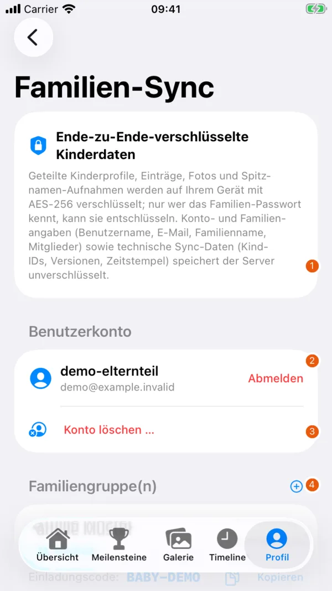

# Familien-Synchronisation

Mit dem Familien-Sync bearbeiten mehrere Familienmitglieder ausgewählte Kinder auf ihren Geräten. Er umfasst deren Profile, Ereignisse, Alltagsprotokolle und unterstützte Medien, einschliesslich Spitznamen-Aufnahmen. Jedes Konto kann auf dem Server einer Familie angehören.

## Familie einrichten

{ width=260 }

| Nr. | Element | Funktion |
| --- | --- | --- |
| 1 | Verschlüsselungshinweis | Erklärt, welche Daten verschlüsselt sind und welche Metadaten der Server sieht. |
| 2 | Benutzerkonto | Zeigt das angemeldete Konto und bietet «Abmelden». |
| 3 | Konto löschen | Öffnet die Erklärung und Bestätigung der Kontolöschung. |
| 4 | Familiengruppe | Öffnet die Familienoptionen. Die Aufnahme verwendet ausschliesslich ein fiktives Konto und einen Demo-Einladungscode. |

1. Öffnen Sie «Profil › Familie & Cloud-Synchronisation › Familien-Synchronisation (E2EE)».
2. Erstellen Sie ein Benutzerkonto oder melden Sie sich an.
3. Wählen Sie «Neue Familie erstellen». Vergeben Sie einen Familiennamen und ein starkes Familien-Passwort. Bewahren Sie es sicher auf.
4. Aktivieren Sie unter «Kinder mit Familie teilen & hochladen» die gewünschten Kinder. Warten Sie, bis der Upload ohne Fehler abgeschlossen ist.
5. Weitere Mitglieder melden sich mit ihrem eigenen Konto an und wählen «Bestehender Familie beitreten». Sie benötigen den Einladungscode und dasselbe Familien-Passwort.

Teilen Sie Passwort und Einladungscode nur mit den vorgesehenen Mitgliedern. Der Betreiber kann ein vergessenes Familien-Passwort nicht wiederherstellen oder zurücksetzen. Aktualisieren Sie alle Familiengeräte, damit sie dieselben Datenformate unterstützen.

## Verschlüsselung und Passwörter

Das Kontopasswort dient zur Anmeldung. Das separate Familien-Passwort verschlüsselt die geteilten Kinderdaten auf dem Gerät. Der Server erhält die verschlüsselten Kinderpakete. Benutzername, E-Mail-Adresse, Familienname, Mitgliedschaft und technische Sync-Metadaten sind davon ausgenommen. Lokale Dateien und [Exporte](backup-and-deletion.md) erhalten diese Verschlüsselung nicht.

Das gespeicherte Familien-Passwort lässt sich in der Familienansicht anzeigen. Der Besitzer der Familie kann es über «Familien-Passwort ändern …» ändern. Anschliessend müssen die anderen Mitglieder unter «Familien-Passwort eingeben …» das neue Passwort hinterlegen. Diese Eingabe ändert nur das auf dem Gerät verwendete Passwort.

Wenn sich ein Kinderpaket nicht entschlüsseln lässt, meldet die App einen Fehler und überschreibt dieses Paket nicht. Prüfen Sie zuerst das Familien-Passwort. Löschen Sie keine lokalen Daten, um einen solchen Fehler zu beheben.

## Änderungen und Verbindungsprobleme

Änderungen an geteilten Kindern lösen automatisch einen Abgleich aus. Offline erfasste Änderungen bleiben ausstehend und werden bei wiederhergestellter Verbindung erneut versucht. Beim Öffnen der App werden auch Änderungen der Familie abgerufen. «Alle Familien synchronisieren» startet einen manuellen Abgleich.

Gleichzeitige Änderungen werden pro Eintrag zusammengeführt. Bei mehreren Bearbeitungen desselben Eintrags entscheidet der Änderungszeitpunkt. Das ersetzt keine Bearbeitungshistorie und keine unabhängige Sicherung. Prüfen Sie wichtige Einträge nach widersprüchlichen Änderungen.

Bei einem Fehler prüfen Sie die Verbindung und die Fehlermeldung. Die Schaltfläche «Cloud-Server» öffnet die Verbindungsdiagnose. Sie zeigt unter anderem Verbindungsstatus und lokale Datenmengen.

## Zugang und Freigaben

«Neuen Einladungscode erstellen» macht den bisherigen Einladungscode ungültig. Bestehende Mitglieder bleiben in der Familie. Ein einzelnes Mitglied lässt sich in der App nicht entfernen. Auch ein neues Passwort kann bereits heruntergeladene Kopien nicht zurückholen.

Das Ausschalten der Freigabe eines Kindes oder «Abmelden» löscht dessen Serverkopie nicht. Für das Entfernen von Daten lesen Sie zuerst [Sichern und Löschen](backup-and-deletion.md).
