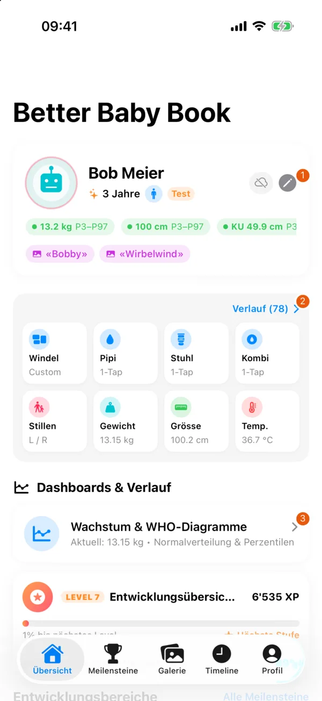
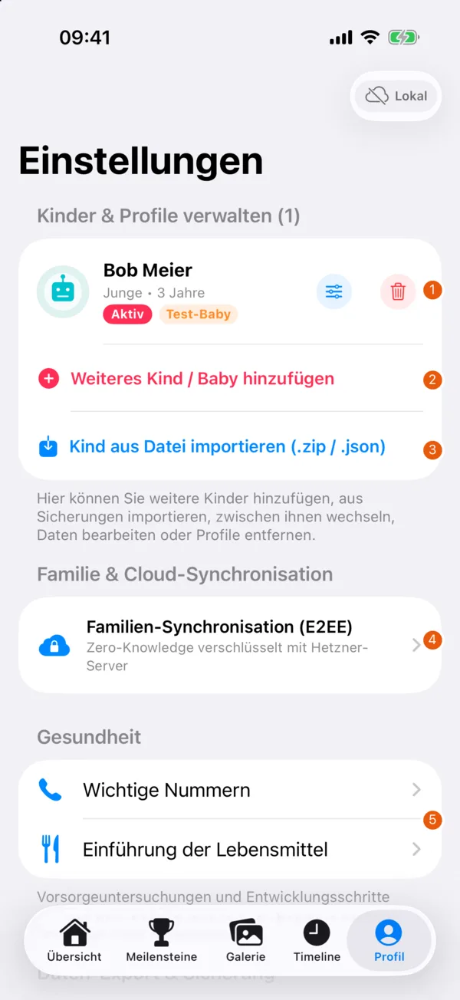
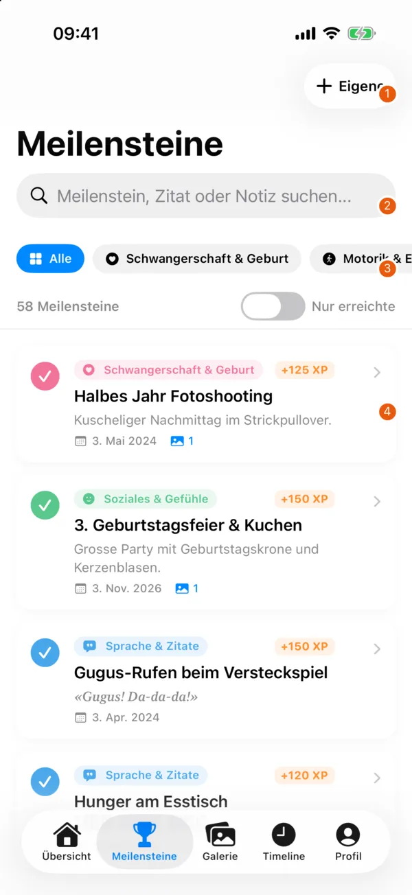
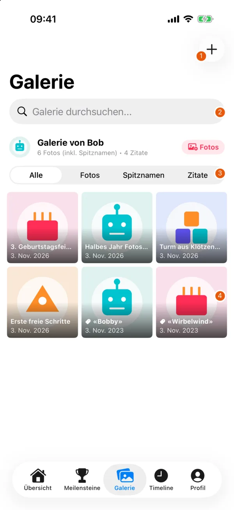
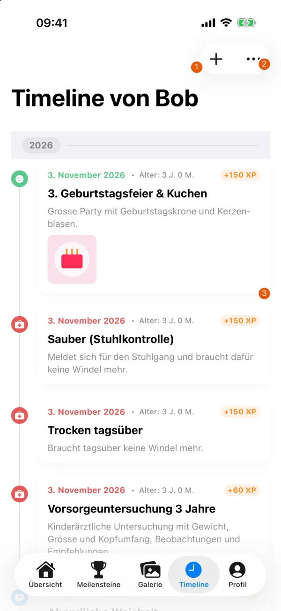
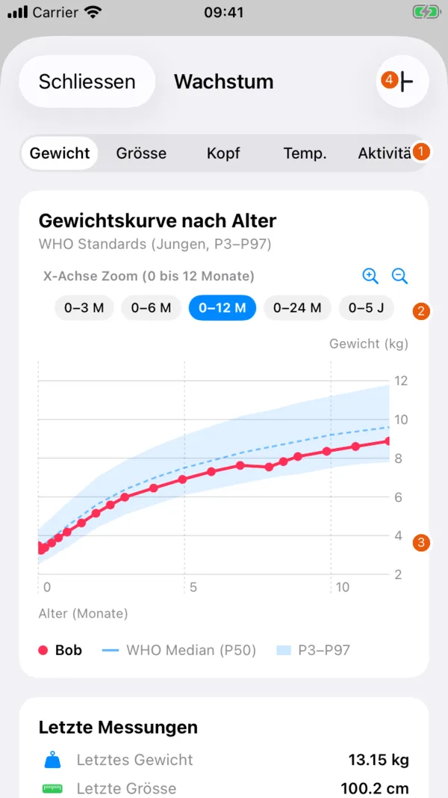
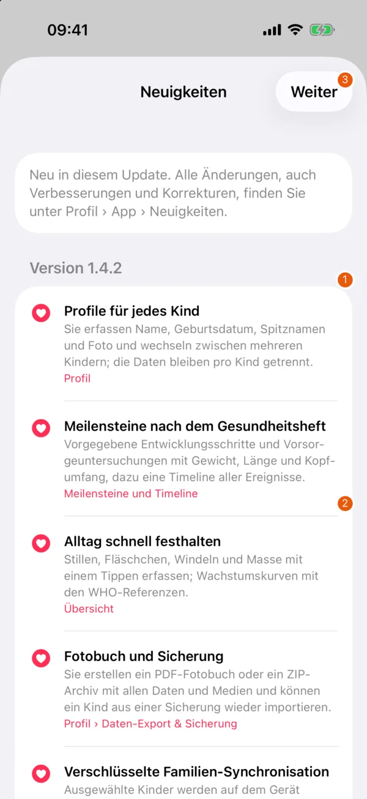

# Features

The captures show the real app, version 1.4.2 (16), on dedicated simulators. The test child, its entries and measurements are fictional. The robot, building blocks and cake are illustrations made for the app content. The numbered markers explain the controls. The app's interface is in German.

## Overview

{ width=260 }

| No. | Element | Function |
| --- | --- | --- |
| 1 | Child card | Shows the active child, age and the latest measurements. The pencil opens the profile editor. |
| 2 | Quick tracking and "Verlauf" (History) | The tiles record daily entries. "Verlauf" opens the previous logs. |
| 3 | "Wachstum & WHO-Diagramme" (Growth & WHO charts) | Opens measurements and reference curves. |

The tabs at the bottom switch between "Übersicht" (Overview), "Meilensteine" (Milestones), "Galerie" (Gallery), "Timeline" and "Profil" (Profile).

## Children and profiles

{ width=260 }

| No. | Element | Function |
| --- | --- | --- |
| 1 | Child row | Selects the child. The buttons edit the profile or start the confirmed deletion. |
| 2 | "Weiteres Kind / Baby hinzufügen" (Add another child / baby) | Creates another profile. |
| 3 | "Kind aus Datei importieren" (Import child from file) | Opens a ZIP or JSON backup. |
| 4 | "Familien-Synchronisation" (Family sync) | Opens sign-in, family and sharing. |
| 5 | "Gesundheit" (Health) | Opens important phone numbers and information on introducing solid food. |

Under "Profil" you manage the children. You can edit name, date of birth and photo, add more children and switch between profiles. Events and daily logs always belong to the selected child, so check which profile is active before you add an entry.

Nicknames can have their own photos and voice recordings. A recording needs microphone access. Photos are only added once you select them. Images imported into events are downsized for the app, so keep the originals separately.

## Milestones and memories

{ width=260 }

| No. | Element | Function |
| --- | --- | --- |
| 1 | "Eigene" (Custom) | Adds your own milestone. |
| 2 | Search | Searches milestones, quotes and notes. |
| 3 | Categories and filters | Limits the list to categories or to reached milestones. |
| 4 | Event card | Opens the entry with date, notes and photos. |

"Meilensteine" contains predefined developmental steps and check-ups. You can also create your own events, enter date and notes and add photos. Check-up entries can hold weight, length and head circumference.

A reference age is not a deadline by which a child must have reached a step. Experience points and levels are a playful view of the recorded memories, not an assessment of development.

## Gallery

{ width=260 }

| No. | Element | Function |
| --- | --- | --- |
| 1 | Plus | Opens a new photo or memory entry. With the "Zitate" (Quotes) filter it opens a new quote. |
| 2 | Search | Searches the gallery. |
| 3 | Content type | Switches between all content, photos, nicknames and quotes. |
| 4 | Thumbnail | Opens the item. You can zoom photos in the image viewer. |

The gallery collects the content of the active child.

## Timeline

{ width=260 }

| No. | Element | Function |
| --- | --- | --- |
| 1 | Plus | Adds an event. |
| 2 | More | Offers the sort orders "Älteste zuerst" (Oldest first) and "Neueste zuerst" (Newest first). |
| 3 | Event | Shows date, category, notes and attached media in chronological order. |

## Daily logs and growth

{ width=260 }

| No. | Element | Function |
| --- | --- | --- |
| 1 | Measure | Switches between weight, height, head, temperature and activity. |
| 2 | Period | Chooses the age range shown. The magnifiers change the zoom. |
| 3 | Chart | Shows the values entered. For weight, WHO references are shown alongside. |
| 4 | Plus | Adds a measurement or log entry. |

Quick tracking on "Übersicht" records breastfeeding, bottles, nappies and measurements such as weight, length, head circumference or temperature. In the history lists you can edit or remove entries. After deleting a log entry, "Rückgängig" (Undo) is available for a short time.

"Wachstum & WHO-Diagramme" shows your measurements with WHO reference curves. The age at the time of measurement is used. The curves do not replace a professional assessment. Input or measuring errors can change what the chart shows.

Under "Profil › Gesundheit" you find "Wichtige Nummern" (Important numbers) and "Einführung der Lebensmittel" (Introducing solid food). This information is for orientation only. Discuss questions about your child's care with medical professionals. In an emergency, contact your local emergency services.

## Export and restore

"Profil › Daten-Export & Sicherung › Vollständiger Daten-Export" (Profile › Data export & backup › Full data export) offers a ZIP data archive and a PDF photo book. The ZIP is for backups and later import, the PDF for viewing or printing. Details and limits are in [Backup and deletion](backup-and-deletion.md).

## Settings and what's new

{ width=260 }

| No. | Element | Function |
| --- | --- | --- |
| 1 | Version and entry | Assigns the change to an app version and describes the function. |
| 2 | Location | Names the area where you find the function. |
| 3 | "Weiter" (Continue) | Closes the what's-new view that opened after an update. |

Under "Profil › App › Neuigkeiten" (Profile › App › What's new) you find the changes. After an update with new functions, the view opens once with those new functions. No update message is shown on first launch.

"Profil › App › Feedback & Ideen senden" (Send feedback & ideas) prepares an e-mail. "Haftungsausschluss" (Disclaimer) keeps the notes on use and health available. The privacy policy is in the "Über" (About) section.
