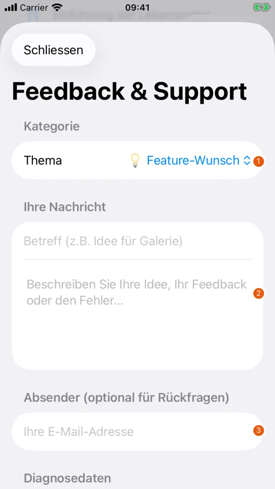

# Feedback and development

{ width=260 }

| No. | Element | Function |
| --- | --- | --- |
| 1 | "Thema" (Topic) | Chooses the category of the message. |
| 2 | "Ihre Nachricht" (Your message) | Takes the subject and description. |
| 3 | "Absender" (Sender) | Optional e-mail address for follow-up questions. |

Further down you can select diagnostic details and prepare the e-mail.

Under "Profil › App › Feedback & Ideen senden" (Profile › App › Send feedback & ideas) you write a message and select diagnostic details if needed. The app prepares an e-mail to [apps@cblum.ch](mailto:apps@cblum.ch). The message is only sent when you send it in your mail app. Diagnostic details are the app version, operating system and device type.

Describe the affected screen, your steps and what you saw. You can give a contact address for follow-up questions. Only send details or photos of your child when they are needed to clarify the problem. Messages in English or German are welcome.

## Public tracker

- [Open reports for Better Baby Book](https://github.com/CyrilBlum/app-feedback/issues?q=is%3Aopen+label%3A%22app%3A+Better+Baby+Book%22)
- [In progress](https://github.com/CyrilBlum/app-feedback/issues?q=is%3Aopen+label%3A%22app%3A+Better+Baby+Book%22+label%3A%22status%3A+in+progress%22)
- [Closed reports](https://github.com/CyrilBlum/app-feedback/issues?q=is%3Aclosed+label%3A%22app%3A+Better+Baby+Book%22)
- [Report a problem](https://github.com/CyrilBlum/app-feedback/issues/new?template=bug.yml) or [suggest a feature](https://github.com/CyrilBlum/app-feedback/issues/new?template=feature.yml)

Reading needs no account. To report or comment on GitHub you need a GitHub account. Without one, write by e-mail.

!!! warning "Reports on GitHub are public"
    Do not post names, e-mail addresses, health data, photos of children, family passwords or invitation codes there. Check screenshots before uploading them. Use e-mail for personal details.

The [changelog](changelog.md) describes changes and says where to find them in the app.
