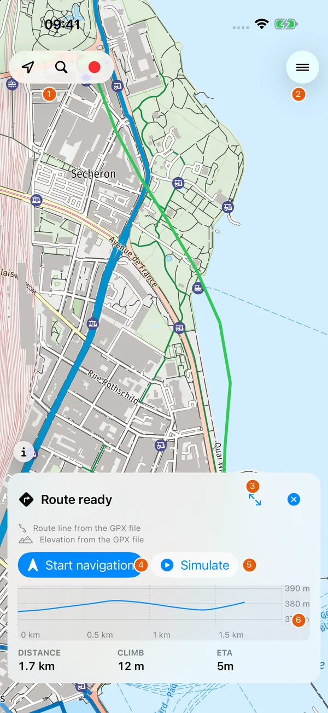
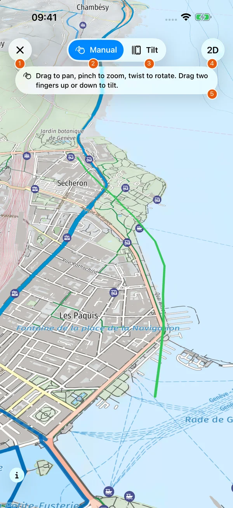
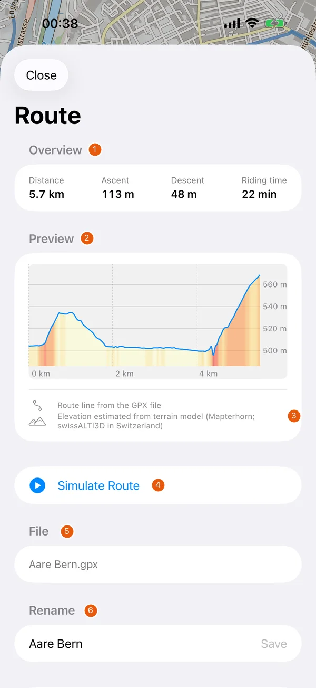
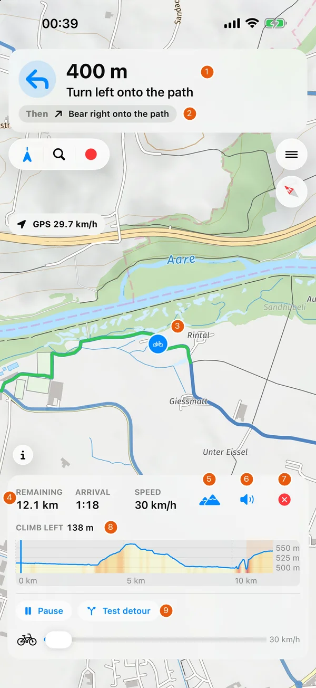
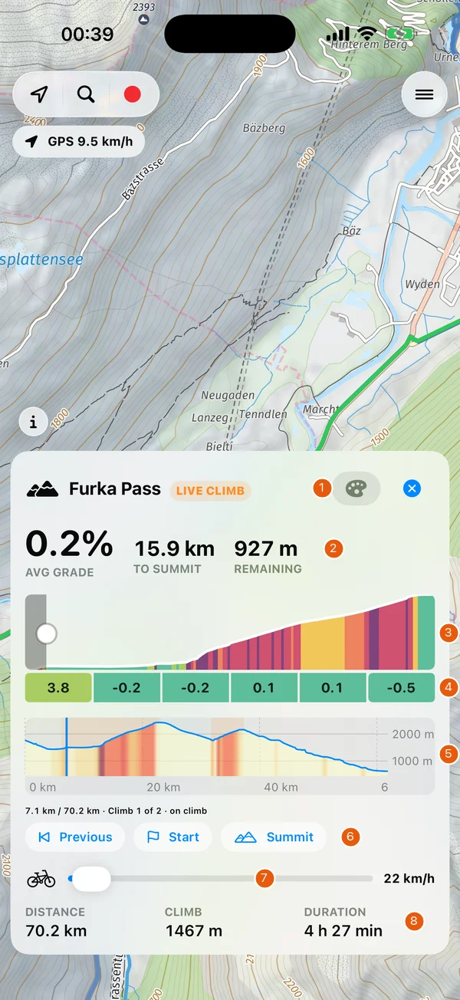
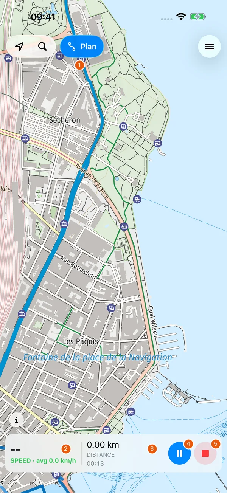

# Features

Control names below use the English interface. In German, the app follows the iPhone language.

The numbered images are actual app screenshots from build 32, captured on a dedicated iPhone simulator on 30 October 2026. They use a fictional Geneva GPX and public test routes. Navigation and climb figures are simulated. Newer builds can differ. Only the explanatory number markers have been added.

## Map and search

{ width=300 }

| # | Element | Function |
| --- | --- | --- |
| 1 | Position, search and record controls | Follow your position, find a place or start a ride recording |
| 2 | Map menu | Open routes, map style, overlays, settings and About |
| 3 | Expand route card | Open Route details |
| 4 | Start navigation | Follow the loaded route using your position |
| 5 | Simulate | Preview the loaded route without riding |
| 6 | Elevation profile | Inspect the loaded route's elevations; this example uses fictional GPX values |

The map menu contains Map style and Overlays. Bicycle emphasises the cycle network and terrain. Car uses a road-map style. Appearance can be Bright, Dark or Auto, which follows the iPhone's appearance. Changing the map type also resets the default route overlays.

Overlays control cycle routes, hiking routes, public transport stops and points of interest. Railway and tram lines remain part of the base map. About › App Guide › Map Legend explains the symbols for the selected style. Map data & licences is available from the map menu and the map's information control.

The position control cycles the map's follow mode. The compass returns the map to north.

Use the magnifying glass for place/address search or nearby categories such as toilets and shops. Place/address search uses Apple. Nearby search uses Cycloputer's map data and works with the downloaded map. Tap a map symbol to inspect its name and kind. Swiss public transport stops can show departures and an SBB link, which require a connection.

### 3D terrain

{ width=300 }

| # | Element | Function |
| --- | --- | --- |
| 1 | Close | Return to the flat map |
| 2 | Manual | Pan, pinch, rotate and tilt with touch gestures |
| 3 | Tilt | Move the terrain view by tilting the iPhone |
| 4 | 2D | Return to a top-down view in Manual mode |
| 5 | Gesture help | Explains the available gestures for the selected mode |

In Tilt mode the level control recalibrates the view. The 3D view needs a connection even when the offline map is installed.

## Plan and inspect a route

Tap Plan to enter the Route builder. Tap the map to place waypoints. Hold and drag a waypoint to move it. The editor offers:

| Control | Use |
| --- | --- |
| Undo | Remove the last waypoint |
| Reverse | Reverse the direction of the route |
| Loop | Join the route back to its start |
| Points | Inspect and manage the waypoints |
| Options | Choose travel mode, road preference and gradient preference |
| Simulate | Preview the route and its climbs |
| Save | Save the current route as GPX |
| Cancel | Leave the route editor |

Open Route details from the loaded route card to inspect distance, ascent, descent, ETA and the elevation profile. The route and elevation source labels distinguish imported GPX data, calculated routes, terrain data and straight-line estimates. Missing elevation data stays unavailable.

{ width=300 }

| # | Element | Function |
| --- | --- | --- |
| 1 | Overview | Distance, ascent, descent and estimated time |
| 2 | Elevation profile | Elevation over route distance |
| 3 | Source labels | State where the route line and elevations came from |
| 4 | Simulate Route | Preview the route |
| 5 | File | Name of the saved GPX file |
| 6 | Rename | Change the saved route's name |

Road and gradient preferences affect local routing with the offline routing package. They are not guarantees about the surface or difficulty of a route. See [how routing is selected](routing-and-data.md#route-calculation).

## Saved routes and file exchange

Open Saved routes in the map menu. Search by name, then use a route's actions menu to Load, Simulate Route, Rename…, Share GPX, Export as KML or Delete…. Recorded rides show distance, moving time and climb. Planned routes are labelled separately.

Import GPX is also available in Saved routes. Importing another file with the same name creates a separate copy. Sharing GPX or KML creates a readable file containing location information. Deleting a saved route asks for confirmation and cannot be undone. The active recording cannot be renamed or deleted.

## Navigation and simulation

Start navigation follows a loaded route with turn prompts, street names, roundabout instructions and a preview of the next instruction. Spoken prompts can be controlled with the speaker button or Settings › General › Voice guidance. If you leave the route, the app detects the deviation and can calculate a way back.

{ width=300 }

| # | Element | Function |
| --- | --- | --- |
| 1 | Rider marker | Position along the route; simulated in this image |
| 2 | Speaker | Mute or enable spoken guidance |
| 3 | Close | End navigation |
| 4 | Next turn | Instruction and distance to the turn |
| 5 | Following turn | Preview of the instruction after that |
| 6 | Simulation controls | Pause, test a detour and adjust simulated speed; these controls belong to the simulation |

Instructions depend on route geometry, routing and map data, as well as GPS reception. Read signs and assess the route independently. Navigation does not confirm access rights or road conditions.

Simulate previews the route without recording a real ride. Its controls let you pause, adjust progress and inspect climbs. Simulation figures do not measure your fitness or predict your actual performance.

{ width=300 }

| # | Element | Function |
| --- | --- | --- |
| 1 | Palette | Colour the route by grade segments |
| 2 | Profile | Elevation curve, highlighted climb sections and current simulation position |
| 3 | Previous, Start, Summit | Jump between climbs and their landmarks |
| 4 | Speed slider | Change the simulated rider's speed |
| 5 | Route totals | Distance, climb and estimated time for the example route |

## Recording and settings

The red record control starts a ride. The dashboard shows speed, distance and time. Use Pause or Resume as needed. End ride opens a confirmation with End and Save Ride. A recording that has ended cannot be continued.

{ width=300 }

| # | Element | Function |
| --- | --- | --- |
| 1 | Plan | Open the route builder while the recording dashboard is shown |
| 2 | Speed | Current speed and average speed; no movement was recorded in this example |
| 3 | Distance and time | Recorded distance and elapsed ride time |
| 4 | Pause | Pause the recording; changes to Resume while paused |
| 5 | End ride | Ask for confirmation before ending and saving the recording |

Settings › General offers metric or imperial units, the assumed speed used for ETA, map appearance, voice guidance, offline packages and Keep Display On While Recording. Settings › Climb View controls grade segments, colours and the summit celebration.

Settings › Sensors currently marks heart rate, cadence and power as unavailable. Cycloputer does not connect to Bluetooth sensors or read Apple Health data.

About contains Show Feature Walkthrough, Map Legend, What's New, contact and privacy information, and the safety and liability notice.
