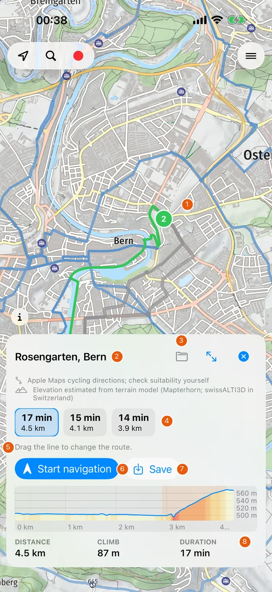
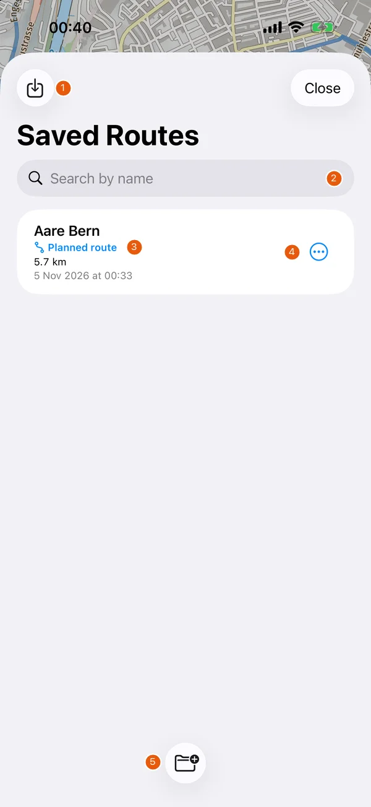

# Features

Control names below use the English interface. In German, the app follows the iPhone language.

The numbered images are actual app screenshots from build 50, captured on a new iPhone simulator on 5 November 2026. The sample route «Aare Bern» was calculated with the app's offline routing on OpenStreetMap ways, and its elevations come from the app's terrain model. Navigation and climb figures come from simulated rides on public test routes. Newer builds can differ. Only the explanatory number markers have been added.

## Map and search

{ width=300 }

| # | Element | Function |
| --- | --- | --- |
| 1 | Position, search and record controls | Follow your position, find a place or start a ride recording |
| 2 | Map menu | Open routes, map style, overlays, settings and About |
| 3 | Route name | Name the route; for a saved route the new name applies at once |
| 4 | Folder | Put the route into a coloured folder |
| 5 | Expand route card | Open Route details |
| 6 | Source labels | Where the route line and the elevations come from |
| 7 | Start navigation | Follow the loaded route using your position |
| 8 | Simulate | Preview the loaded route without riding |
| 9 | Elevation profile | Elevation along the route, coloured by the grade in your direction of travel; drag across it to see the spot on the map |
| 10 | Distance, climb and duration | Duration is the riding time over the profile (see [riding time](#riding-time)) |

The map menu contains Map style and Overlays. Bicycle emphasises the cycle network and terrain. Car uses a road-map style. Appearance can be Bright, Dark or Auto, which follows the iPhone's appearance. Changing the map type also resets the default route overlays. Battery saver shows a black map with only roads, names and your route.

Overlays control cycle routes, hiking routes, public transport stops and points of interest. Railway and tram lines remain part of the base map. About › App Guide › Map Legend explains the symbols for the selected style. Map data & licences is available from the map menu and the map's information control.

The position control cycles the map's follow mode. The compass returns the map to north.

Use the magnifying glass for place/address search or nearby categories such as toilets and shops. Place/address search uses Apple. Nearby search uses Cycloputer's map data and works with the downloaded map. Tap a map symbol to inspect its name and kind. Swiss public transport stops can show departures and an SBB link, which require a connection.

### 3D terrain

{ width=300 }

| # | Element | Function |
| --- | --- | --- |
| 1 | Close | Return to the flat map |
| 2 | Manual | Pan, pinch, rotate and tilt with touch gestures |
| 3 | Tilt | Move the terrain view by tilting the iPhone |
| 4 | 2D | Return to a top-down view in Manual mode |
| 5 | Gesture help | Explains the available gestures for the selected mode |

Tilting the map with two fingers on the flat map also opens the 3D view. In Tilt mode the level control recalibrates the view. The 3D view needs a connection even when the offline map is installed.

## Plan and inspect a route

Tap Plan to enter the Route builder. Tap the map to add waypoints; each tap continues from the last point. Tap or drag a waypoint to select it; a red button above it deletes it, and the next tap on the map only releases the selection. Put your finger on the route line and drag it: the route is recalculated through your finger while you drag, and a new waypoint appears where you let go, already selected. The editor offers:

| Control | Use |
| --- | --- |
| Undo | Revert the last drawing action (also by shaking the iPhone) |
| Reverse | Reverse the direction of the route |
| Loop | Join the route back to its start |
| Options | Choose travel mode (bicycle, speed pedelec, hiking, car), road preference and gradient preference |
| Save | Save the current route as GPX |
| Cancel | Leave the route editor |

The speed pedelec mode is for e-bikes up to 45 km/h. With the offline routing package it keeps routes to paved ways and assumes a higher cruising speed. It does not check restrictions for mopeds, so follow the signs. The travel mode is remembered for later routes.

### Go to a place

{ width=300 }

| # | Element | Function |
| --- | --- | --- |
| 1 | Destination | The place you pressed and held on the map or picked in the search |
| 2 | Place name | Shown as the route's name until you rename it |
| 3 | Folder | Choose a folder before saving |
| 4 | Alternatives | Riding time and distance of each proposal; tap one or its grey line to select it |
| 5 | Drag hint | Drag the line to change the route |
| 6 | Start navigation | Navigate without saving; the proposal is discarded when the navigation ends |
| 7 | Save | Keep the proposal as a saved route |
| 8 | Route figures | Distance, climb and riding time of the selected proposal |

Press and hold a place on the map or pick a search result, choose the travel mode next to Route if needed, and tap Route. The app takes a fresh position and proposes routes from there, up to three where the routing offers alternatives. If you leave a proposed route while navigating, a new route is calculated through the waypoints still ahead.

### Route details

{ width=300 }

| # | Element | Function |
| --- | --- | --- |
| 1 | Overview | Distance, ascent, descent and riding time |
| 2 | Preview | Elevation over route distance |
| 3 | Source labels | State where the route line and elevations came from |
| 4 | Simulate Route | Preview the route |
| 5 | File | Name of the saved GPX file |
| 6 | Rename | Change the saved route's name |

The route and elevation source labels distinguish imported GPX data, calculated routes, terrain data and straight-line estimates. Missing elevation data stays unavailable.

Road and gradient preferences affect local routing with the offline routing package. They are not guarantees about the surface or difficulty of a route. See [how routing is selected](routing-and-data.md#route-calculation).

### Riding time

Riding time uses the elevation profile and a speed on level ground for each travel mode (Settings › General › Riding time estimate).

| Travel mode | How the time is calculated |
| --- | --- |
| Bicycle | Constant pedalling effort: climbs take longer, descents are faster, at most 40 km/h |
| Speed pedelec | The motor helps on climbs; never faster than 45 km/h |
| Hiking | DIN 33466 hiking rule: 300 m ascent or 500 m descent per hour at 4 km/h on the flat |
| Car | The set speed; terrain is ignored |

Without an elevation profile the time is the distance at the set speed. Stops, traffic, surfaces and wind are not included. During navigation the arrival time is the current time plus the time for the rest of the route, updated with every position.

## Saved routes and file exchange

{ width=300 }

| # | Element | Function |
| --- | --- | --- |
| 1 | Import GPX | Load a GPX file from Files |
| 2 | Search | Filter routes by name |
| 3 | Route type | Planned route or recorded ride, with distance and date |
| 4 | Actions | Load, Simulate Route, Rename…, Move to Folder, Share GPX, Export as KML or Delete… |
| 5 | New folder | Create a coloured folder |

Recorded rides show distance, moving time and climb. Routes appear on the map in their folder's colour. Importing another file with the same name creates a separate copy. Sharing GPX or KML creates a readable file containing location information. Deleting a saved route asks for confirmation and cannot be undone. Deleting a folder keeps its routes. The active recording cannot be renamed or deleted.

## Navigation and simulation

Start navigation follows a loaded or proposed route with turn prompts, street names, roundabout instructions and a preview of the next instruction. If you leave the route, the app detects the deviation and shows a way back or, for a proposed route, calculates a new one.

{ width=300 }

| # | Element | Function |
| --- | --- | --- |
| 1 | Next turn | Instruction and distance to the turn |
| 2 | Following turn | Preview of the instruction after that |
| 3 | Rider marker | Position along the route; simulated in this image |
| 4 | Remaining, arrival, speed | Remaining distance, arrival time and current GPS speed |
| 5 | Mountain | Show or hide the elevation profile (remembered) |
| 6 | Speaker | Mute or enable spoken guidance |
| 7 | Close | End navigation |
| 8 | Climb left and profile | Elevation gain still ahead and the route profile with your position; on a climb the climb's own profile takes its place |
| 9 | Test drive controls | Pause, test a detour and adjust the simulated speed; these controls belong to the simulation |

Pinch the map with two fingers during navigation to zoom in or out around your position; the navigation keeps the zoom you chose. A Live Activity shows the next turn, the remaining distance and the arrival time on the Lock Screen and in the Dynamic Island. Spoken prompts can also be switched off in Settings › General › Voice guidance.

Instructions depend on route geometry, routing and map data, as well as GPS reception. Read signs and assess the route independently. Navigation does not confirm access rights or road conditions.

Simulate previews the route without recording a real ride. Its controls let you pause, adjust progress and inspect climbs. Simulation figures do not measure your fitness or predict your actual performance.

{ width=300 }

| # | Element | Function |
| --- | --- | --- |
| 1 | Palette | Colour the route by grade segments |
| 2 | Climb figures | Average grade ahead, distance to the summit and elevation remaining |
| 3 | Climb profile | The climb's elevation with the simulated position |
| 4 | Grade segments | Grade of each segment of the climb |
| 5 | Route profile | Whole route with its climbs highlighted |
| 6 | Previous, Start, Summit | Jump between climbs and their landmarks |
| 7 | Speed slider | Change the simulated rider's speed |
| 8 | Route totals | Distance, climb and riding time for the example route |

## Recording and settings

The red record control starts a ride. The dashboard shows speed, distance and time. Use Pause or Resume as needed. End ride opens a confirmation with End and Save Ride. A recording that has ended cannot be continued.

Settings › General offers metric or imperial units, the speeds for the riding time estimate, map type and appearance, voice guidance, offline data, Keep display on and Battery saver. Settings › Climb View controls grade segments, colours and the summit celebration.

Settings › Sensors currently marks heart rate, cadence and power as unavailable. Cycloputer does not connect to Bluetooth sensors or read Apple Health data.

About contains Show Feature Walkthrough, Map Legend, What's New, Feedback & Development, contact and privacy information, and the safety and liability notice.
