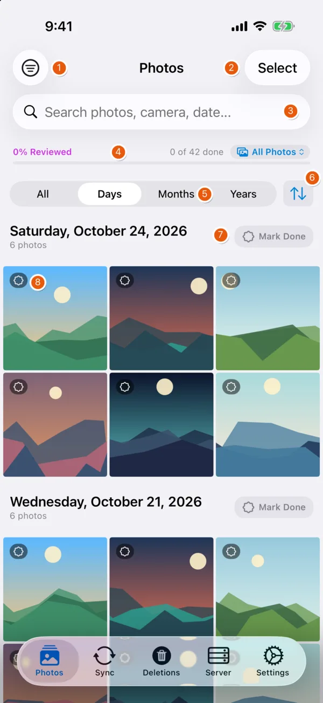
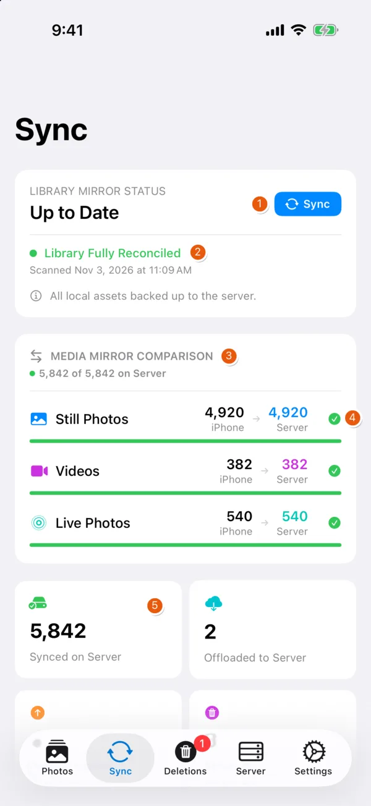
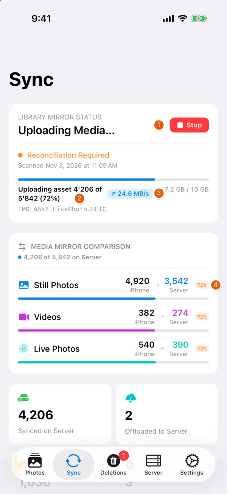
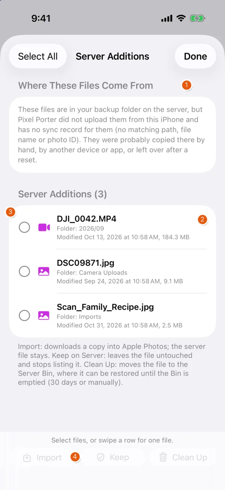
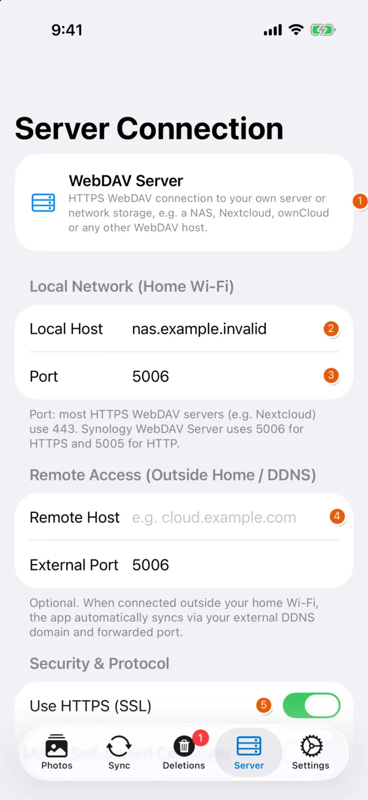
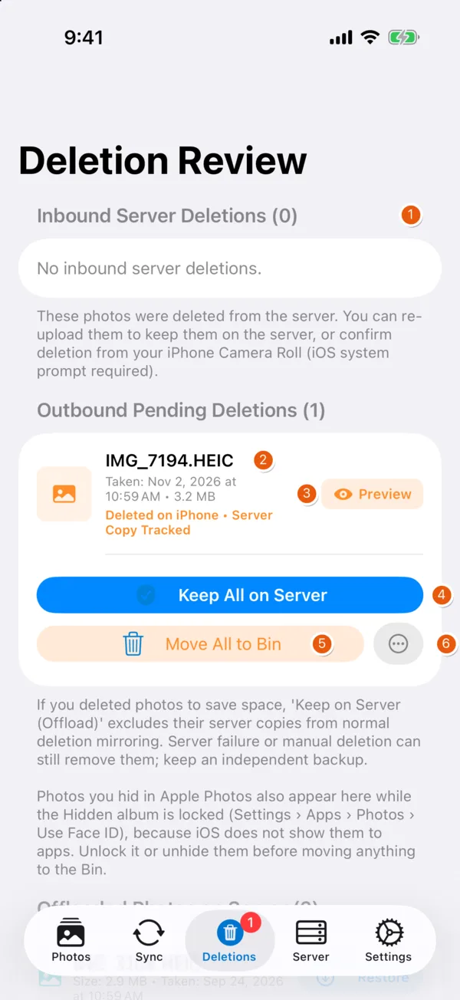
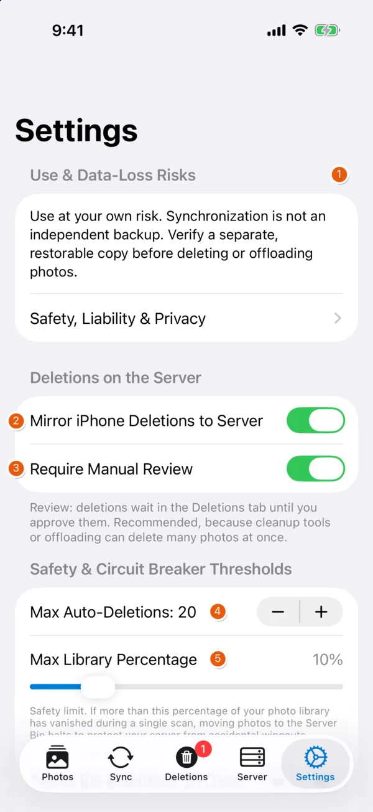
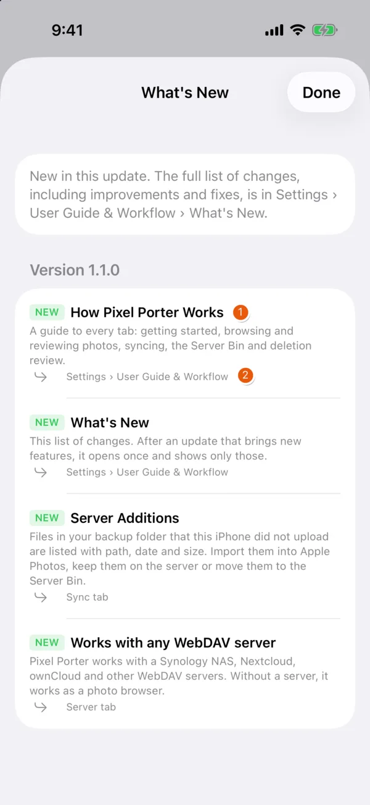

# Features

Screenshots from the current build on a dedicated iPhone 17 Pro simulator with fictional demo data: synthetic artwork in the gallery, the reserved host `nas.example.invalid`, invented counts and file names. No real library, server or account.

## Photos

{ width=260 align=right }

| # | Element | Function |
| --- | --- | --- |
| 1 | Filter | Year, camera model, media type, review status, Hidden album |
| 2 | Select | Multi-select: share, favorite, hide, compare (2+), delete |
| 3 | Search | Photos by camera or date |
| 4 | Review progress | Share of items marked reviewed; filter All / Not Reviewed / Reviewed |
| 5 | Grouping | Days, Months, Years or ungrouped |
| 6 | Sort | Date or file size, ascending or descending |
| 7 | Mark Done | Marks the whole day, month or year as reviewed |
| 8 | Badges | Review state and server state per item |

The viewer adds zoom, video scrubbing, EXIF and histogram, side-by-side comparison and an editor (adjustments, filters, crop, rotate, trim). Edits are saved to Apple Photos with their EXIF and location data. Every deletion goes through the iOS confirmation dialog.

## Sync

{ width=260 align=right }

| # | Element | Function |
| --- | --- | --- |
| 1 | Sync | Scan, upload, then stage deletions and server changes for review. Secondary: Rescan Only, Dry-Run Preview |
| 2 | Mirror status | Result of the last scan and reconciliation |
| 3 | Mirror comparison | Items on iPhone vs. server, per type |
| 4 | Per-type state | Complete, or the percentage still missing |
| 5 | Counters | Items synced to and offloaded on the server |

Further down: Server History (uploads and Bin moves by day), inbound changes from the server, and **Free Up Space**, which deletes local copies of uploaded items and marks them as offloaded (restorable from the server).

{ width=260 align=right }

| # | Element | Function |
| --- | --- | --- |
| 1 | Stop | Cancels the run; deletion mirroring is skipped for an incomplete scan |
| 2 | Progress | Current item, count, bytes transferred |
| 3 | Throughput | Live upload rate |
| 4 | Per-type progress | Share already on the server |

Uploads stream to a temporary file on the server and are renamed into place only when complete. Background sync runs when iOS grants time; it is not guaranteed.

## Server Additions

{ width=260 align=right }

| # | Element | Function |
| --- | --- | --- |
| 1 | Provenance | Why these files are listed: in the backup folder, but not uploaded by this iPhone |
| 2 | File details | Folder, modification date, size |
| 3 | Selection | Select files for a batch action, or swipe a row |
| 4 | Actions | **Import** into Apple Photos, **Keep** (stop listing), **Clean Up** (move to the Server Bin) |

Each action asks for confirmation. Cleaned-up files can be restored to their original folder from the Bin.

## Server

{ width=260 align=right }

| # | Element | Function |
| --- | --- | --- |
| 1 | Server type | Generic WebDAV |
| 2 | Local host | Address on the home network, probed first (2 s timeout) |
| 3 | Port | Synology WebDAV: 5006 (HTTPS); most others: 443 |
| 4 | Remote host | Optional address for outside the home network (DDNS or public name), used when the local probe fails |
| 5 | HTTPS | On by default. Self-signed certificates need an explicit toggle |

Further down: user name, password (Keychain), destination path, Bin path, connection test. The external port defaults to 5006 (Synology WebDAV HTTPS); set the port your router forwards.

## Deletions

{ width=260 align=right }

| # | Element | Function |
| --- | --- | --- |
| 1 | Inbound | Files deleted on the server: re-upload, or delete from Apple Photos |
| 2 | Outbound | Items deleted on the iPhone whose server copy still exists |
| 3 | Preview | Loads the server copy |
| 4 | Keep All on Server | Leave server copies untouched |
| 5 | Move All to Bin | Move server copies to the dated Server Bin |
| 6 | More | Delete directly without the Bin (confirmation required) |

Further down: Offloaded Photos (restore to Apple Photos) and the Server Bin (restore, purge, empty items older than the retention period).

## Settings

{ width=260 align=right }

| # | Element | Function |
| --- | --- | --- |
| 1 | Risk notice | Permanent link to safety, liability and privacy notes |
| 2 | Mirror iPhone Deletions | Off by default: server copies are only listed |
| 3 | Require Manual Review | On by default: mirrored deletions wait for approval |
| 4 | Max Auto-Deletions | Circuit breaker, absolute (default 20) |
| 5 | Max Library Percentage | Circuit breaker, relative (default 10 %) |

Further down: Bin retention (default 30 days), weekly sync and review reminders, camera-model filter, inbound server sync, diagnostic log export, guide, What's New, reset.

## What's New

{ width=260 align=right }

| # | Element | Function |
| --- | --- | --- |
| 1 | Entry | Type (new, improved, fixed) and title |
| 2 | Location | Where to find the feature in the app |

Settings › User Guide & Workflow › What's New lists every entry. After an update with new features, the sheet opens once and shows only those. The same data produces the [changelog](changelog.md).

