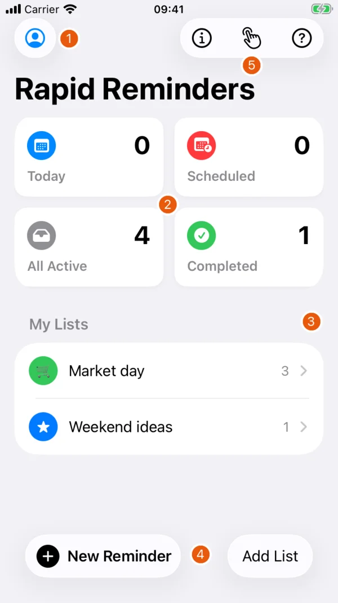
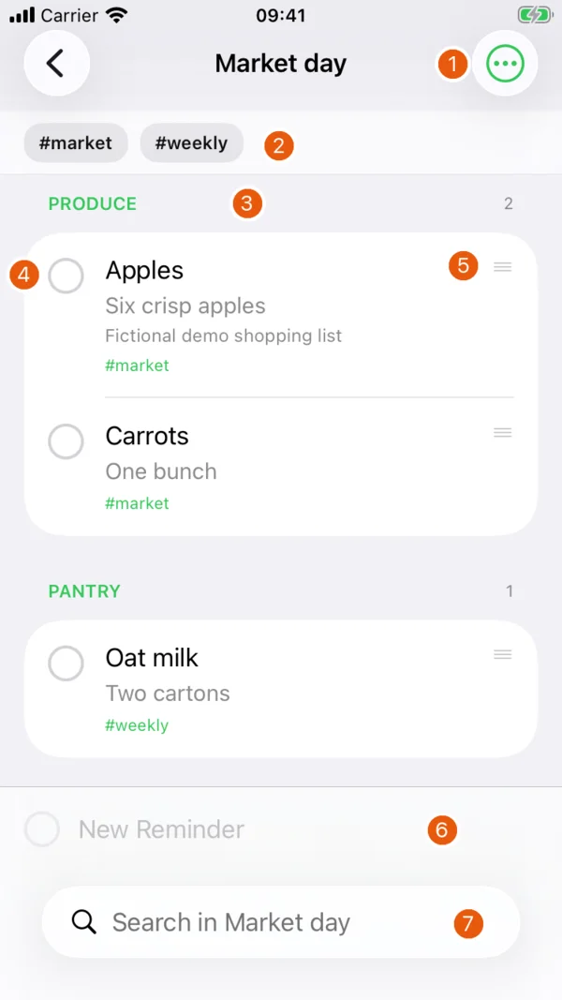
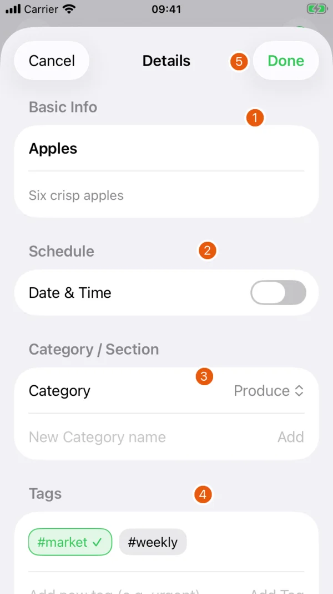
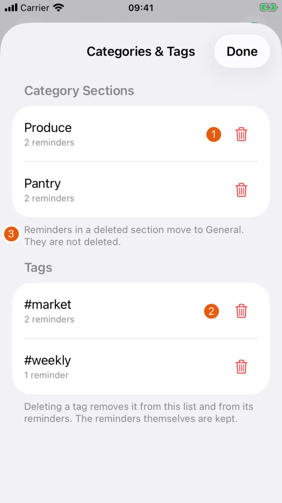

# Features

These are real app screenshots from version 1.1 (6), captured on 3 November 2026 on a fresh iPhone SE simulator. Shopping items, lists and sharing details are fictional. No personal account or live service was used. Orange numbers refer to the tables beside each screen. The illustrated controls are also present in the current development source.

## Dashboard and lists

{ width=260 }

| # | Element | Function |
| --- | --- | --- |
| 1 | Account | Sign in, create an account or open your profile |
| 2 | Smart lists | Today, Scheduled, All Active and Completed across your lists |
| 3 | My Lists | Open a named list |
| 4 | Add buttons | Add a reminder with the full editor, or create a list |
| 5 | Help buttons | About & Usage, Home Screen shortcuts and the walkthrough |

Open a smart-list card to see matching items across lists. A dated reminder can appear in a smart list without being moved from its own list.

Use **Add List** to create a list. Choose its colour and an emoji or symbol. Inside a list, the menu's **List Settings & Appearance** opens its name and appearance settings. A list shared with you as **View only** has no editing controls.

## Inside a list

{ width=260 }

| # | Element | Function |
| --- | --- | --- |
| 1 | List menu | Completed items, categories, sharing, calendar feed and list settings |
| 2 | Tags | Filter the list by a tag |
| 3 | Category heading | Groups items into sections |
| 4 | Checkbox | Complete and hide the item |
| 5 | Drag handle | Move an item within or between categories |
| 6 | New Reminder | Enter another item without opening the full editor |
| 7 | Search | Search within this list |

Tap an item's text to open its details. The quick-entry field stays available at the bottom when the list is editable and no search is active.

## Add and edit reminders

The **New Reminder** field at the bottom of a list is the quick-entry path. The full reminder editor offers these details:

{ width=260 }

| # | Element | Function |
| --- | --- | --- |
| 1 | Basic Info | Title and subtitle |
| 2 | Date & Time | Enable an optional due date and time |
| 3 | Category | Select or create a section |
| 4 | Tags | Choose labels or add another tag |
| 5 | Done | Save changes to this item |

The title is required. Scroll further down for notes, a URL, involved people and deletion. Involved people are entered as text, without importing Contacts or assigning an account.

Choose **Add** for a new item or **Done** after editing. **Cancel** closes the editor without saving those edits. A view-only item's **Details** screen allows reading without editing.

## Complete and reuse

Ticking an item marks it completed and hides it from the ordinary list. It does not delete the item. The list menu offers **Show Completed Items** and **Hide Completed Items**.

Entering a matching hidden or completed title reactivates the existing item. This is useful for recurring shopping items. To remove an item permanently, use **Delete** and read its confirmation. Deletions in a synchronized list are sent to the service and affect shared content.

## Categories and tags

{ width=260 }

| # | Element | Function |
| --- | --- | --- |
| 1 | Category trash button | Remove the section after confirmation |
| 2 | Tag trash button | Remove the tag from this list and its items |
| 3 | Category deletion notice | Explains that items move to General and are kept |

Open the list menu and choose **Add Category Section...** to add a section. Drag items between categories to reorganize them. Items without a category appear under **General**.

Use **Add Tag...** or the reminder editor to create tags. A tag filter narrows the visible items. **Manage Categories & Tags...** lets you remove categories or tags after confirmation. Deleting a category keeps its reminders and moves them to **General**. Deleting a tag removes the label from the list's reminders.

## Search

Search on the main screen finds lists and reminders. Search inside a list limits the results to that list. Use the hidden/completed option in search when an item you expect is missing. The search screen can show matching completed items without permanently changing the list's normal visibility setting.

## Shortcuts and help

The main screen's **Home Screen shortcuts** button opens instructions. A list also offers **Add Home Screen Shortcut...**. The app's Shortcuts actions and URL scheme open the app or a list. They do not add a separate guarantee of alarm delivery.

The information button opens **About & Usage** with privacy and risk notices and **What's New**. After an update with new features, What's New opens once with those new features. The complete [changelog](changelog.md) remains available there.

For online features, continue with [Sync, sharing and data](sync-and-data.md).
