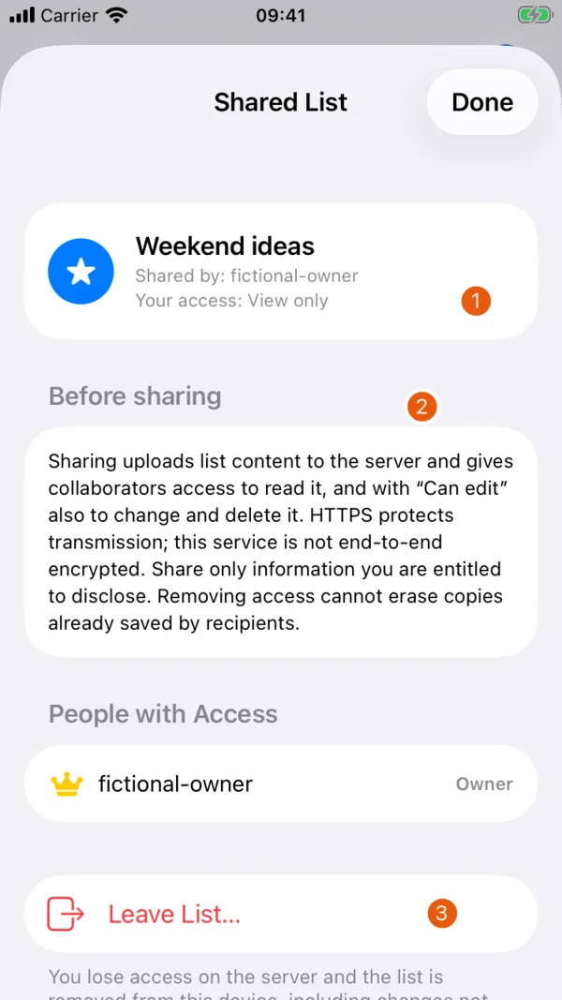
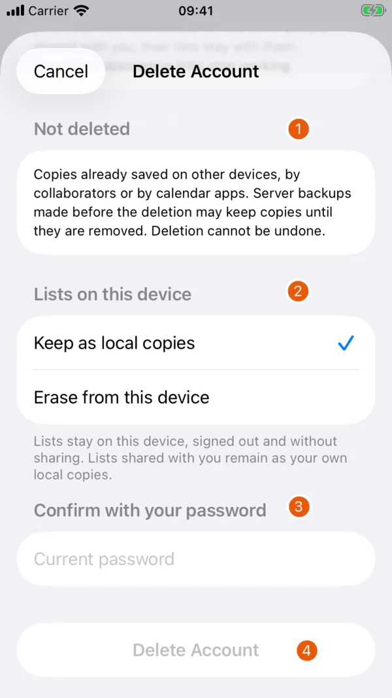

# Sync, sharing and data

## Local use and accounts

Without an account, lists and reminders are stored locally in the app. The app does not read your existing Apple Reminders lists. Removing the app's local data can lose these lists, so keep separate copies of information you need.

Use the account button on the main screen to **Create Account** or **Sign In**. Registration requires email activation. Signing in can upload existing local lists and reminders as well as fetch the account's server data. Review what is on the device before signing into an account.

The optional online features are experimental. HTTPS protects data in transit. List content is not end-to-end encrypted and can be read by the service operator. Avoid confidential, health-related or business-critical content. See the [privacy policy](https://cblum.ch/en/projects/rapidreminders/privacy/) for processing and retention details.

## Offline changes and errors

Edits and deletions made while offline are kept on the device and queued for later sync. The app retries when it returns to the foreground. You can also pull down on the main list to refresh. If the dashboard shows **Sync failed**, read the error and use **Retry Sync** after restoring connectivity.

Unsynced local edits are retained during merging until sent successfully. A view-only shared list follows the server's content and cannot be edited. Sync is not guaranteed to be immediate. Before changing devices or deleting local data, check that the needed content has reached the other device.

**Sign Out** keeps local lists and does not delete the server account or its content. Pending changes stay on the device for a later sign-in. Signing out is not a way to erase data.

## Share a list

{ width=260 }

This actual app view uses a fictional sharing preview from version 1.1 (6), captured on 3 November 2026. It does not show a real account or a live invitation.

| # | Element | Function |
| --- | --- | --- |
| 1 | Your access | Shows the participant's View only permission |
| 2 | Before sharing | Explains server access, encryption limits and retained copies |
| 3 | Leave List | Removes the participant's access after confirmation |

1. Open your list's menu and choose **Share List...**.
2. Enter the other person's Rapid Reminders username.
3. Choose **Can edit** or **View only**, then **Invite**.
4. Review the collaborators in the sharing sheet. The owner can change access or remove a collaborator after confirmation.

An editor can change the shared content. A view-only participant can read it. Share only information the participants are entitled to see. Removing access cannot erase copies they already saved.

Participants can open **People & Leave List...** and choose **Leave List…**, then confirm. The list is removed from their device after the server confirms and remains with its owner. An owner cannot leave their own list through this action.

## Subscribe in a calendar

1. Open a list's menu and choose **Calendar Subscription Feed...**.
2. Sign in if needed. A working link requires your account's calendar token.
3. Choose **This List Only**, **All My Lists**, or **Select Multiple Lists...**. With selected lists, select at least one.
4. Choose **Subscribe in Apple Calendar**, or **Copy Calendar Subscription Link** for a calendar service that accepts an iCalendar subscription URL.

The calendar service decides when to refresh and whether to deliver the feed's alarm instructions. The feed includes an alarm instruction before a dated reminder's time. It can contain completed and hidden items as well as titles, notes and other details. Completing an item in Rapid Reminders does not guarantee it disappears from every calendar copy.

Anyone with the link can read the included calendar data without signing into the app. Do not post it in an issue or screenshot. If the link is exposed, choose **Reset Subscription Link...** and confirm **Reset Link**. This invalidates all existing calendar links for the account, across every list and device. Subscribe again with the new link. Copies already held by calendar providers are not deleted.

## Delete an account

{ width=260 }

This screenshot uses the same fictional simulator session and an empty password field. No deletion request was sent.

| # | Element | Function |
| --- | --- | --- |
| 1 | Not deleted | Lists copies that account deletion cannot remove |
| 2 | Lists on this device | Keep local copies or erase them after server confirmation |
| 3 | Current password | Required before proceeding |
| 4 | Delete Account | Opens the final confirmation, disabled while the password is empty |

Open the account button, then **My Profile › Delete Account…**. Read the explanation, choose **Keep as local copies** or **Erase from this device**, enter the current password and confirm the final deletion alert.

After successful server confirmation, the account and its owned server lists, reminders, categories, tags and shares are removed. Collaborators lose access to those lists. Other people's lists stay with their owners. Your calendar links stop working. The local choice is applied only after the server confirms deletion.

Deletion cannot remove copies already saved on other devices, by collaborators or by calendar services. Earlier server backups can retain copies until their retention period ends. If deletion fails, read the error and retry or contact [apps@cblum.ch](mailto:apps@cblum.ch) without including your password or calendar link.
