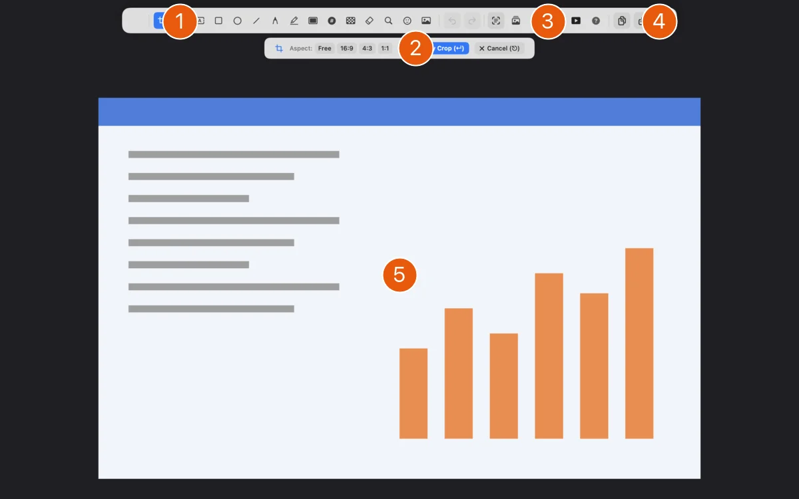
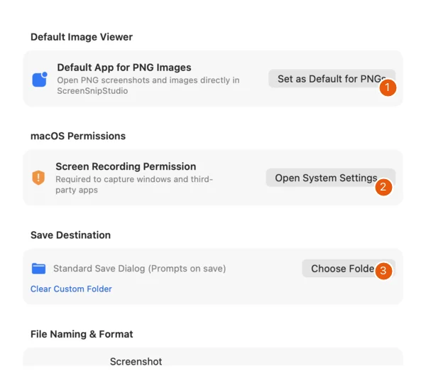
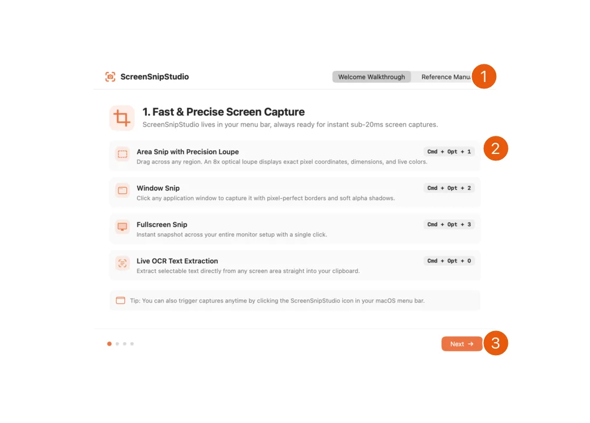

# Features

These images were made on 14.11.2026 from the version 1.0.1 (5) source. They are offscreen captures of the app's actual SwiftUI/AppKit views produced by its snapshot harness. The editor's diagram is fictional input. No user's desktop was captured. No personal image, account or storage credentials were used. Orange numbers are documentation annotations.

## Capture and open

Use the menu bar item for area, window, full-screen and scrolling capture. Area capture lets you draw a region. Window capture selects a window. Full-screen capture includes the target display's content. Check the intended display and anything private visible there before starting.

| Shortcut | Action |
| --- | --- |
| Option+Command+1 | Capture an area |
| Option+Command+2 | Capture a window |
| Option+Command+3 | Capture full screen |
| Option+Command+R | Repeat the last capture area |
| Option+Command+O | Recognise text in an area and copy it |
| Command+O | Open an image or saved project |
| Command+V | Paste an image from the clipboard when opening content |

Scrolling capture scrolls another window and stitches the captured frames. Check the resulting image for missing or repeated content. On-screen permissions and the target app can affect what can be captured. Instant OCR recognises text on the device, but its output still needs checking.

## Editor

| # | Element | Function |
| --- | --- | --- |
| 1 | Tool picker | Choose capture markup, text, shapes and other annotation tools. |
| 2 | Attribute bar | Controls for the current tool. Select / Crop shows aspect ratios and Apply Crop here. |
| 3 | Layers | Open annotation order and visibility controls. |
| 4 | Copy, Save and project controls | Choose an output path. See the save and project explanation before sharing. |
| 5 | Canvas | The synthetic diagram is fictional input inside the real editor view. |

Pick a tool before drawing. Select an existing annotation to change it, move it or adjust the controls shown below the toolbar. Drag handles to resize or reshape it. Arrow keys nudge a selected annotation. Copy, paste and duplicate actions let you reuse annotations. Undo and Redo restore editing steps.

## Annotation tools

| Tool | Use |
| --- | --- |
| Select / Crop | Select and move markup, or draw and apply a crop region |
| Arrow and Line | Point to a detail, with straight or curved paths, arrow styles, thickness and line patterns |
| Text Label | Add text, optionally in a speech bubble with a pointer |
| Rectangle and Oval | Frame a region, with optional fill and text where available |
| Pencil and Highlighter | Draw freely or mark text. The highlighter can use recognised text lines |
| Spotlight | Keep a region prominent while dimming the surroundings |
| Step Counter | Add numbered badges for a sequence |
| Blur & Pixelate | Obscure a region using the chosen mode. Inspect the export before sharing |
| Erase / Inpaint | Remove or fill a region of the image. The result may need correction |
| Magnifier Loupe | Enlarge a detail in a callout |
| Ruler and Guide Lines | Measure or align visible content |
| Overlay Diff | Compare an inserted overlay with the base image |
| Emoji / Sticker and Image | Add a character or another image as an annotation |

The attribute bar changes with the active tool or selected annotation. It includes relevant colour, size, fill, line, pointer and opacity controls. Use the colour inspector for a hex value and contrast information. Picking a tool carries forward its applicable defaults.

## Layers and canvas

Open **Layers** to change annotation order and visibility. A hidden layer remains in an editable project. Select the object you want before changing its attributes.

Use trackpad pinch to zoom and **Command+1** to fit the image. **Command+0** returns to actual-size zoom. Rotation controls and the two-finger rotation gesture turn the canvas in quarter turns. Text remains upright while its position rotates. Backdrops add framing with padding, rounded corners and shadows. Keep an original before applying changes you may need to reverse after closing the editor.

## Settings

| # | Element | Function |
| --- | --- | --- |
| 1 | Default App for PNG Images | Optional action to make the app handle PNG files. |
| 2 | Screen Recording Permission | Open macOS permission settings for capture access. |
| 3 | Save Destination | Choose a custom folder or keep the normal save dialog. Further naming and format settings are below. |

Open **Settings** from the menu bar or **Command+,**. General settings include language, the default image-viewer action, screen-capture permission access, a chosen save directory, naming and format options. A chosen destination controls later saves, so check it before exporting private material.

S3-compatible storage configuration is optional. Read [Projects, exports and privacy](projects-and-sharing.md#optional-upload) before enabling it. The direct-download edition has licence activation settings. The App Store edition does not use that activation service.

## Help and output

| # | Element | Function |
| --- | --- | --- |
| 1 | Guide mode | Switch between the walkthrough and the reference manual. |
| 2 | Capture instructions | Review the capture actions and their shortcuts. |
| 3 | Next | Move through the walkthrough pages. |

The menu bar offers **Walkthrough & Guide**, **What's New** and **Feedback & Development**. The walkthrough introduces capture and editing. Its reference manual explains tools and shortcuts.

Copy sends the composed image to the clipboard. Save writes a flattened image in the selected format. Save Project keeps the original and layers. GIF export reveals annotations step by step. [Projects, exports and privacy](projects-and-sharing.md) explains how to choose between them.

ScreenSnipStudio stays in the menu bar after closing its windows. **Command+Q** closes a window or hides its Dock icon. Choose **Quit ScreenSnipStudio** in the menu bar item to terminate the app.
