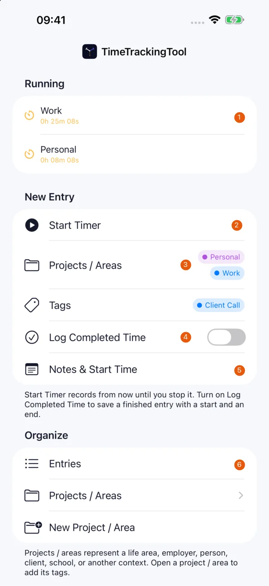
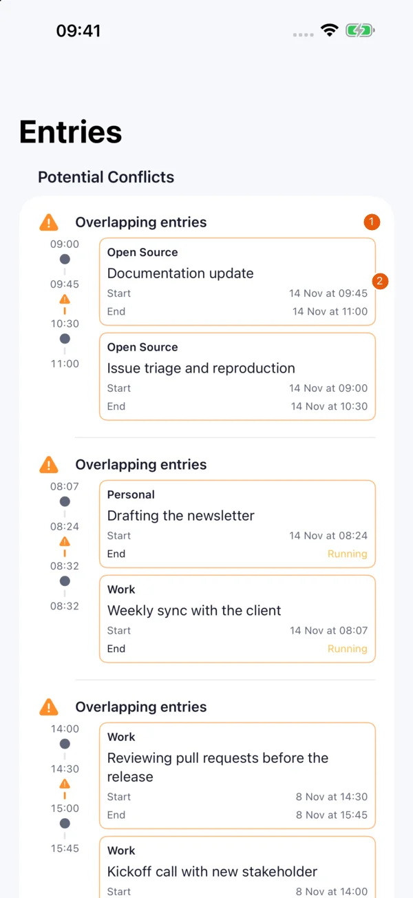
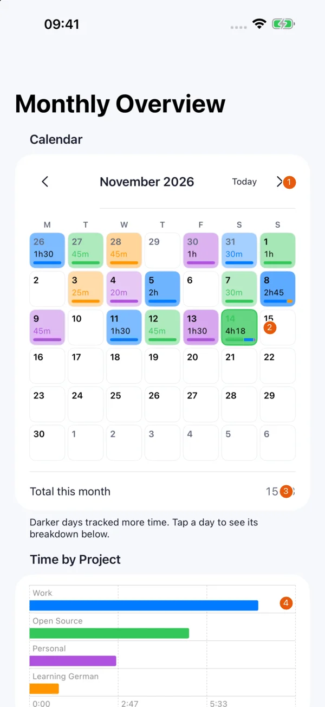
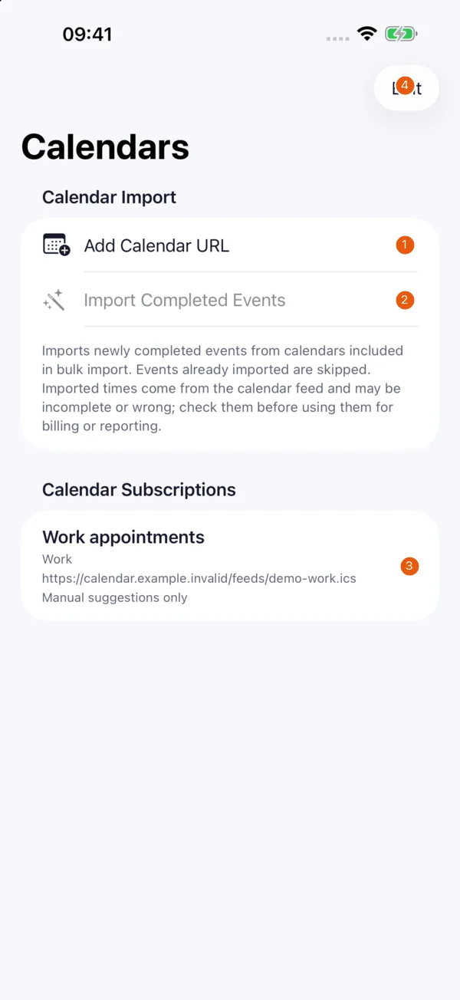

# iPhone features

The screenshots below are real captures of version 1.4 (17), taken on 14.11.2026 in an isolated iPhone 17 Pro Max simulator with iOS 26.5. The projects, entries, notes and calendar address are fictional. Orange numbers identify the controls described beside each image.

## Start and stop time

{ width=260 }

| # | Element | Function |
| --- | --- | --- |
| 1 | Running | Stop an active entry and keep its elapsed time. |
| 2 | Start Timer | Start recording with the current project and tag choices. |
| 3 | Projects / Areas and Tags | Choose what the new entry belongs to. |
| 4 | Log Completed Time | Switch from a running timer to a finished time range. |
| 5 | Notes & Start Time | Add notes or adjust the starting time. |
| 6 | Entries | Review recorded entries and potential overlaps. |

Projects / areas can represent clients, subjects or other work. An entry can belong to several projects, so check how you group entries before adding project totals together. Tags add labels within a project. Tag types in Settings organise tags into separate dimensions.

Start a timer from **New Entry**. Open **Details** or **Notes & Start Time** for notes and a different start time. For work already finished, enable **Log Completed Time**, enter its start and end or duration, then save. A completed entry does not keep running.

In **Running**, stop the entry to preserve its elapsed time. A swipe from the leading edge also stops it. The trailing discard action removes the running entry without saving it. Stopping is also available from the Live Activity on a supported iPhone. Siri, Shortcuts, Control Center and the Home Screen widget offer other ways to start or access tracking.

## Review entries and overlaps

{ width=260 }

| # | Element | Function |
| --- | --- | --- |
| 1 | Potential Conflicts | Shows time ranges that overlap. |
| 2 | Entry card | Open the entry to review and correct its details. |

Open **Entries** and filter by project or tag. The chosen filters remain selected while moving between screens. Select an entry to edit its projects, tags, notes and time range. Canceling changed fields asks before discarding them. Deleting an entry or a selection asks for confirmation.

Potential conflicts identify overlapping time ranges. Parallel work can be intentional, so inspect the entries before changing them. Open the conflict card to edit the relevant entry.

## Projects and tags

Open **Projects / Areas** to create, rename, reorder or delete projects. The **Parent** field creates a sub-project in version 1.4. The list shows the hierarchy and prevents a project from becoming its own ancestor.

Project detail shows an activity calendar and time trend. Entries crossing midnight contribute time to each day they touch. Deleting a project offers choices for its entries. Read the selected option before confirming. Its sub-projects move up a level when the parent is removed on iPhone.

Add tags within a project. In Settings, choose whether to use tag types when you need separate classification dimensions. Removing a tag changes how entries can be filtered.

## Monthly overview and export

{ width=260 }

| # | Element | Function |
| --- | --- | --- |
| 1 | Month controls | Move between months or return to the current month. |
| 2 | Day | Select a day to inspect its recorded time. |
| 3 | Total this month | Shows the time attributed to the selected month. |
| 4 | Time by Project | Compare the month’s time grouped by project. |

Open **Tools › Monthly Overview**, choose the month and select a day to inspect its time. The project chart groups time for that month. Time crossing a month boundary is limited to the portion inside the selected month.

Choose **Tools › Export as CSV** to export entries using the share sheet. Choose the destination yourself. CSV files are readable and may contain project names and notes. Keep them somewhere appropriate for that information. CSV export is a report, with no iPhone CSV restore workflow described here.

## Calendar import

{ width=260 }

| # | Element | Function |
| --- | --- | --- |
| 1 | Add Calendar URL | Configure an authorised subscription for a project. |
| 2 | Import Completed Events | Import past events from included calendars. Disabled here because the fictional feed is not included. |
| 3 | Calendar subscription | Open the feed for individual event suggestions. |
| 4 | Edit | Manage subscriptions and remove one after confirmation. |

Use **Tools › Calendars** to add subscriptions and review events. [Calendars, sync and data](data-and-sync.md#calendar-subscriptions) explains accepted addresses, individual actions and bulk import.

## Help and updates

The first-launch welcome contains help. **Tools › Help** remains available later. **What's New** lists changes and opens once after an update with new features. **About** contains the use notice and privacy link. **Feedback** offers the message form and the public tracker. See [feedback and development](feedback.md).
