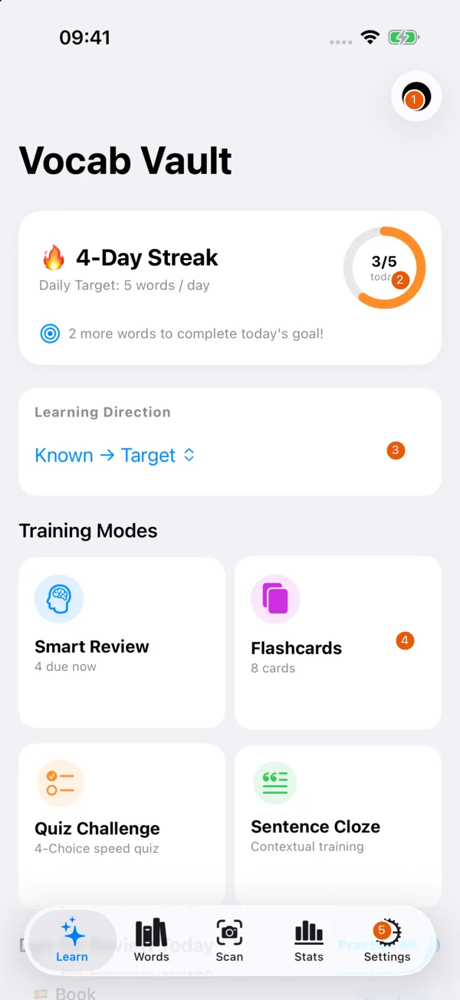
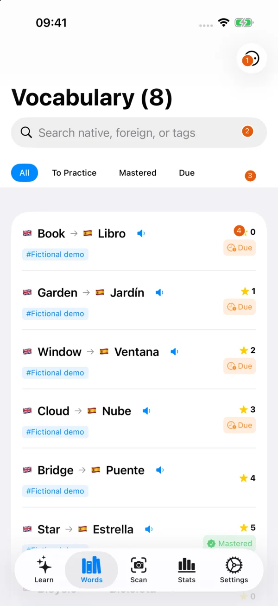
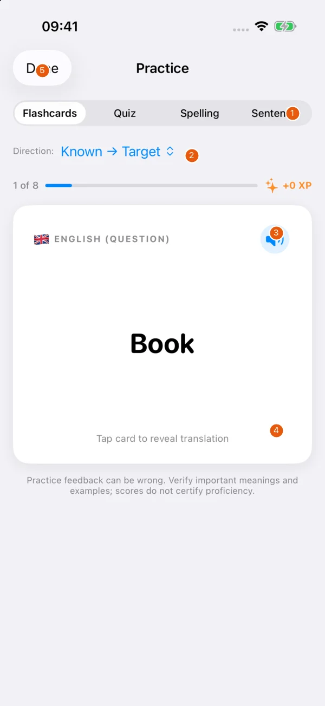
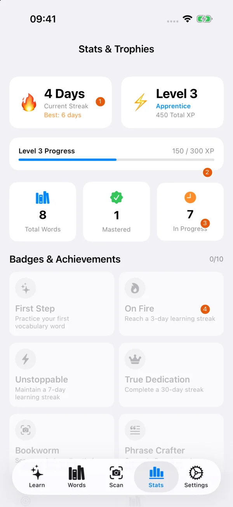

# Features

These are real app captures of version 1.0 (10), taken on 14.11.2026 in a new iPhone 17 Pro simulator running iOS 26.5. The English/Spanish word pairs, progress and tags are fictional. No camera, photo library or personal vocabulary was used. Orange numbers match the explanations beside each screen.

## Learn dashboard

{ width=260 }

| # | Element | Function |
| --- | --- | --- |
| 1 | Add Word | Create a pair with language, tags and examples. |
| 2 | Daily progress | Compare today’s practice with the selected target. |
| 3 | Learning direction | Choose the question and answer direction. |
| 4 | Training modes | Start Smart Review, Flashcards, Quiz Challenge or Sentence Cloze. |
| 5 | Tabs | Move between Learn, Words, Scan, Stats and Settings. |

The dashboard shows your daily target and due words. Choose the learning direction before starting practice. Quick sessions let you review due vocabulary or practise a broader selection. A word being due means its scheduled review date has arrived. It does not mean the word was deleted or forgotten by the app.

## Word library

{ width=260 }

| # | Element | Function |
| --- | --- | --- |
| 1 | Library menu | Open library actions such as adding a word and scan import. |
| 2 | Search | Find native or foreign text and tags. |
| 3 | Status filter | Show all words, words to practise, mastered words or due words. |
| 4 | Word row | Review the pair, tag, score and due state. Speaker controls pronounce the text. |

Open **Words › Add Word** to enter known and target languages, the pair, tags and an example. The example generator uses local templates. Check the result yourself, especially where grammar or meaning matters.

Search matches vocabulary and example text. Use language, tag and status filters to narrow the list, and choose a sort order. Open a word's available actions to practise, edit or delete it. Deletion asks for confirmation.

Speaker controls use Apple's system voices for pronunciation. **Settings › Audio & Speech › Test Speech Pronunciation** helps check output. Pronunciation quality and available voices depend on the system.

## Practice

{ width=260 }

| # | Element | Function |
| --- | --- | --- |
| 1 | Mode | Switch between Flashcards, Quiz, Spelling and Sentence. |
| 2 | Direction | Switch the question and answer direction. |
| 3 | Pronunciation | Hear the displayed word with the system voice. |
| 4 | Flashcard | Tap to reveal the answer and recall-rating controls. |
| 5 | Done | Leave the session. |

Practice offers flashcards, multiple choice, typing and sentence exercises. Choose the direction you want to review. With a flashcard, tap to reveal the answer, then rate the recall using the difficulty buttons. Other modes let you enter or choose an answer and review feedback before continuing. Hints help when you are stuck.

The answer checker uses local matching rules and can accept synonyms or tolerate some typing errors. It cannot reliably assess every valid translation or sentence. Check disputed feedback against your source and correct the stored pair if necessary.

Spaced repetition schedules another review from your answer and difficulty. Correct recall extends the interval. Incorrect recall brings the next review sooner. The displayed interval is a scheduling aid.

## Statistics and goals

{ width=260 }

| # | Element | Function |
| --- | --- | --- |
| 1 | Streak | See the current and best activity streaks. |
| 2 | Level progress | See XP and progress toward the next level. |
| 3 | Word counts | Compare total, mastered and in-progress vocabulary. |
| 4 | Achievements | Review earned and locked badges. Scroll for further statistics. |

**Stats** shows vocabulary progress, learned words by month and achievements. The monthly learned count is based on when a mastered word was learned, with older records using the available historical date.

**Settings › Daily Target (Words/Day)** sets the target. Learning activity contributes to streaks, XP and levels. **Reset Streak & XP** asks before resetting gamification. It keeps the vocabulary words. These indicators measure activity within the app and do not certify language ability.

## Scanning and updates

Open **Scan** to use the camera or a chosen photo, then review the recognised word pairs. [Scanning, CSV and data](import-and-data.md) explains corrections, unfinished drafts and duplicate handling.

**Settings › About › What's New** lists the release history. Updates with new features show their highlights once. **Settings › Feedback & Development** contains the form and public tracker. [Feedback and development](feedback.md) explains what to include in a report.
