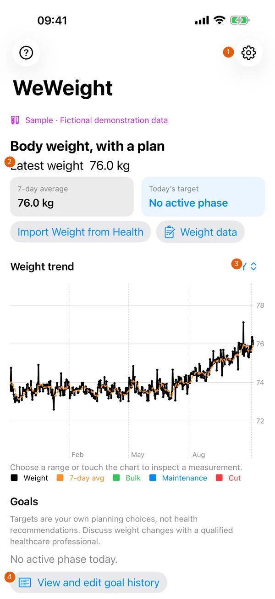
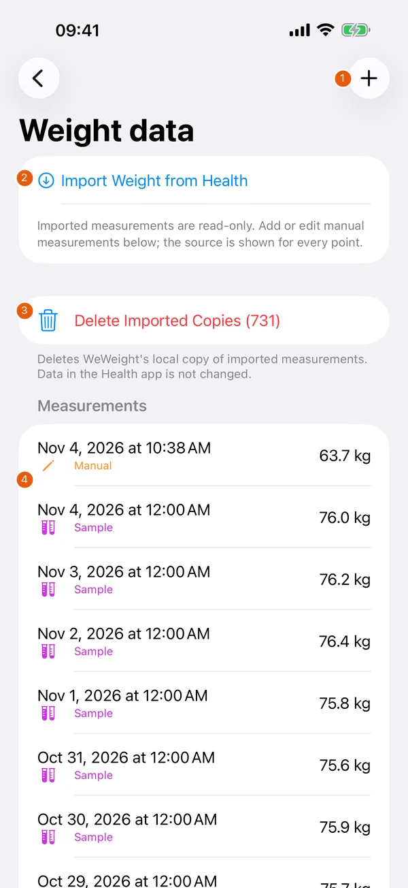
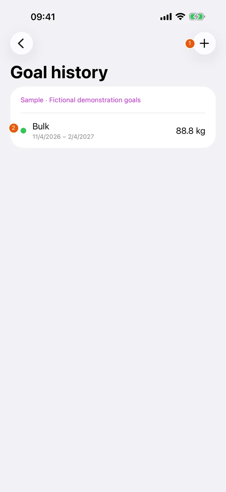
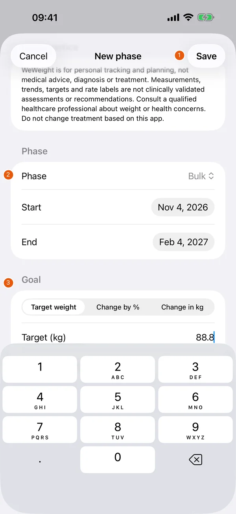
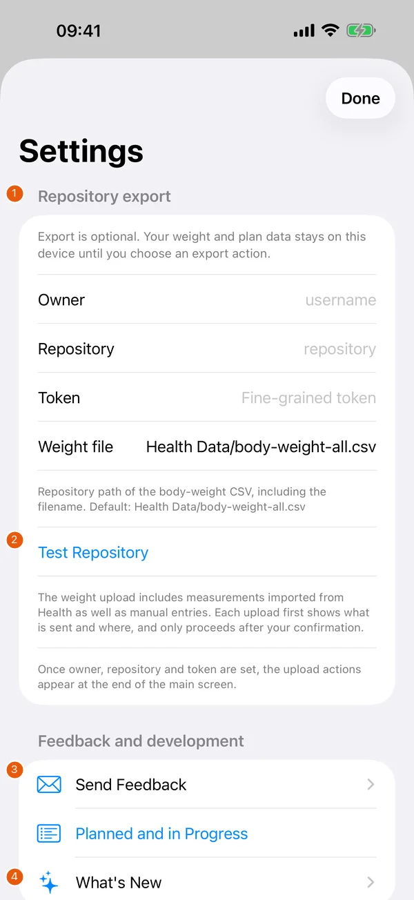
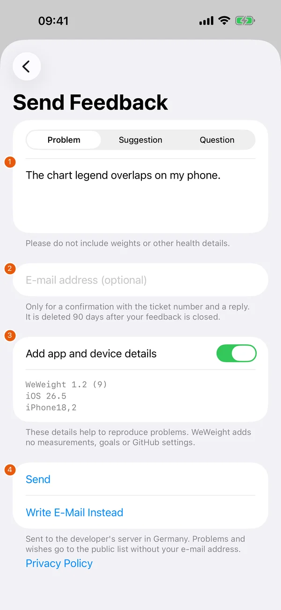

# Features

The screenshots show fictional demonstration data in WeWeight 1.2 (9), captured on 04.11.2026. The visible Sample banner is a test-fixture label. It does not describe your own measurements. See [Data and exports](data-and-exports.md) for deletion, CSV and repository behaviour.

## Weight trend

{ width=260 }

| # | Element | Function |
| --- | --- | --- |
| 1 | Settings | Open repository settings, feedback and release notes. The ? button on the other side opens help. |
| 2 | Summary | Latest measurement, trailing 7-day average and today’s target. No active phase means there is no target for today. |
| 3 | Chart and range | Select the visible period with the range control. Touch the chart to inspect a measurement. Black marks are weights, orange is the average; goal phases have their own colours. |
| 4 | Goal history | Open your saved phases to add, edit or delete a plan. |

## Measurements

{ width=260 }

| # | Element | Function |
| --- | --- | --- |
| 1 | Add measurement | Use + to enter a weight in kilograms and a date, then Save. Tap a manual entry to edit it. |
| 2 | Import Weight from Health | Read body-weight measurements from Health after granting access. Progress and a result are shown. |
| 3 | Delete Imported Copies | Remove WeWeight’s imported copies after confirmation. Manual entries and the data in Health stay. |
| 4 | Measurement list | Each row shows its date, weight and source. Swipe a manual entry to delete it, then confirm. Sample labels appear only in these fictional demonstration captures. |

## Goal history

{ width=260 }

| # | Element | Function |
| --- | --- | --- |
| 1 | Add phase | Use + to create a new phase. |
| 2 | Phase row | Shows the phase, dates and final target. Tap to edit. Swipe to delete and confirm. These values are fictional examples, not recommended targets. |

## Creating a phase

{ width=260 }

| # | Element | Function |
| --- | --- | --- |
| 1 | Save or cancel | Save a valid phase. Cancel closes the editor; unsaved changes may require a discard confirmation in later builds. |
| 2 | Phase and dates | Choose Bulk, Cut or Maintenance and set the start and end dates. |
| 3 | Goal entry | Choose a target weight, percentage change or change in kilograms. Rate entry supports weekly or monthly changes. Scroll to reach fields hidden by the keyboard. Labels describe your chosen plan and are not health recommendations. |

## Settings

{ width=260 }

| # | Element | Function |
| --- | --- | --- |
| 1 | Repository fields | Optional GitHub owner, repository, fine-grained token and weight-file path. Leave them empty for local tracking. |
| 2 | Test Repository | Check access before using the upload actions. See Data and exports for permissions and upload confirmation. |
| 3 | Send Feedback | Open the report form. Planned and in Progress opens the public tracker. |
| 4 | What’s New | Read the release history. Privacy and health notices are further down the settings screen. |

## Feedback form

{ width=260 }

| # | Element | Function |
| --- | --- | --- |
| 1 | Type and message | Choose Problem, Suggestion or Question, then describe the issue. Do not include health data. |
| 2 | Optional e-mail | Enter an address only if you want a ticket confirmation and reply. |
| 3 | App and device details | Review the displayed version and device details and switch inclusion off if you prefer. Measurements, goals and GitHub settings are excluded. |
| 4 | Send or e-mail | Send the form or open your mail app with Write E-Mail Instead. The pictured submission was a test stub; it sent no report. |

